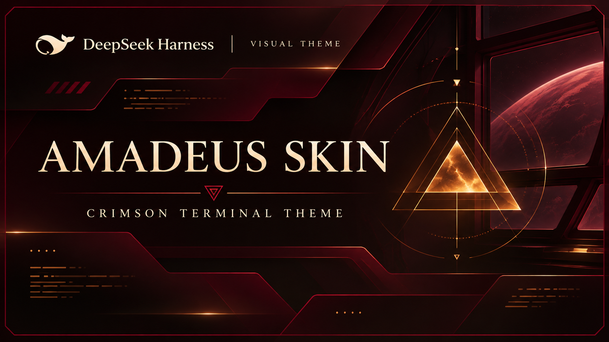
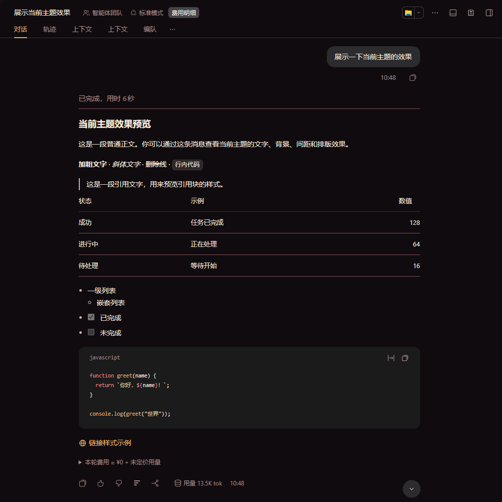
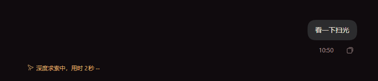

# DSH Amadeus Skin



[简体中文](README.zh-CN.md)

A local DeepSeek Harness (DSH) web theme bundle, independent of the Amadeus workbench.

> **Artwork rights:** The Amadeus image is sourced from [Yink/Amadeus](https://github.com/Yink/Amadeus), but its provenance and permission to use or redistribute are unverified. No authorization is claimed or guaranteed; verify rights before use or distribution. The MIT code license does not cover third-party artwork, which is also embedded in `client.js`. See [ASSETS.md](ASSETS.md).

## Features

- Dark crimson, black and warm gold palette; light wine-colored palette also available. Dark mode is recommended.
- Theme overrides for text, backgrounds, code syntax, links and buttons, with static terminal ornaments and Amadeus marks in the sidebar, welcome area and composer.
- Does not read chat content, change the model or require a network connection. Decorations are not status indicators.

## Installation

### Plugin market (only if listed)

If this bundle becomes available in your configured DSH plugin market, find it there and install it using the market's install action. Availability is not guaranteed; otherwise use the local method below.

### Manual local install

1. Obtain the complete bundle directory locally. Its package is private (`@local/dsh-amadeus-skin`); it is not an npm publication.
2. In DSH, ask the agent to call `plugin_manager` with `action: "install_bundle"` and `target` set to the **absolute path to the bundle directory** (the directory containing `package.json`), not a relative path or an individual file. For example, use your own path in `{"action":"install_bundle","target":"C:\\path\\to\\dsh-amadeus-skin"}` (or an absolute POSIX path).
3. Installation affects every session in the current profile. Check for an existing bundle with the same name before replacing it. Enable the bundle and plugin if necessary and select dark mode in Appearance. Check the installation's application result and warnings: installation does not guarantee activation, and replacing loaded modules may require restarting DSH.
4. Disable or uninstall the bundle to remove it from the profile. Other active themes may affect its appearance.

## Build and test

Node.js is required; no package installation is needed. From this directory:

```sh
npm run build
npm test
```

Rebuild after changing `client.source.js` or `amadeus-logo.png`: the build generates `client.js` with the image embedded. Tests run in a simulated environment and do not verify the live UI.

## Compatibility

Designed for the DSH web client. No supported version range has been established; future DSH changes may break the skin. Some theme variables depend on implementation details, and shared tokens can affect other components or themes. Check rendering, interactions and contrast in your DSH version; automated tests are not visual or accessibility certification.

## Screenshots

Dark conversation view (account and usage details cropped):



Activity indicator:



## License

Code: [MIT](LICENSE). Artwork rights are separate; see [ASSETS.md](ASSETS.md).
