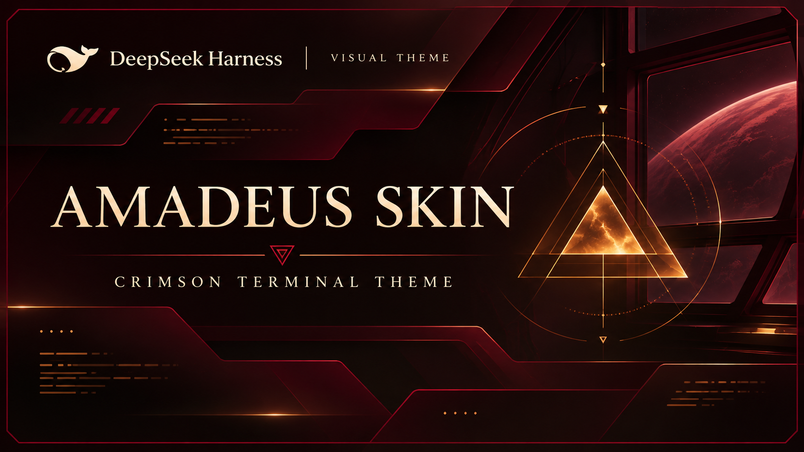
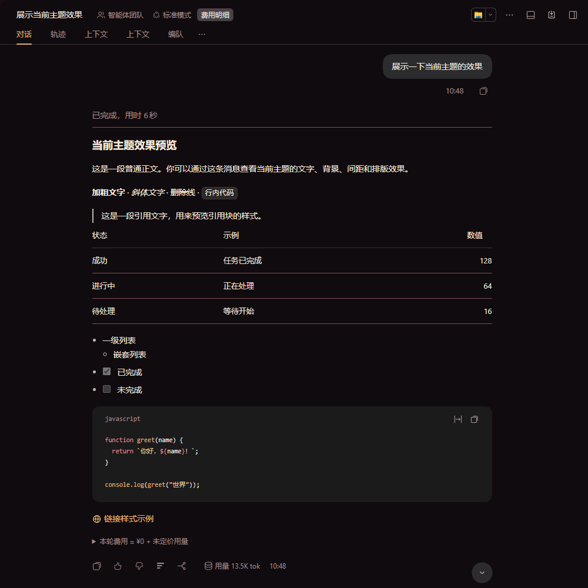
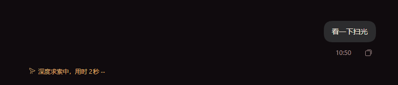

# DSH Amadeus 皮肤



[English](README.md)

独立于 Amadeus 工作台的本地 DeepSeek Harness（DSH）Web 主题插件包。

> **素材权利提示：** Amadeus 图像来自 [Yink/Amadeus](https://github.com/Yink/Amadeus)，其原始来源及使用或再分发许可尚未核实；不声称或保证已获得授权，使用或分发前请自行核实权利。代码的 MIT 许可不涵盖第三方素材，`client.js` 中也内嵌了该图像。详见 [ASSETS.md](ASSETS.md)。

## 功能

- 深色模式采用黑红与暖金配色，也提供浅酒红配色；推荐深色模式。
- 覆盖文字、背景、代码语法、链接和按钮等主题令牌，在侧边栏、欢迎区和输入区显示静态终端装饰及 Amadeus 徽记。
- 不读取聊天内容、不更改模型，皮肤本身无需网络；装饰不表示系统状态。

## 安装

1. 将本目录放到本地。此插件包为私有包（`@local/dsh-amadeus-skin`），未发布到 npm。
2. 在 DSH 中请助手使用插件管理器的 `install_bundle` 操作，安装本目录的**绝对路径**。安装会修改当前配置档；若已有同名插件包，请先决定是否替换。
3. 必要时启用插件包和插件，然后在外观设置中选择深色模式。检查插件管理器的应用结果，安装成功不代表已经启用；替换已加载模块后可能需要重启 DSH。
4. 禁用或卸载插件包即可移除皮肤；其他启用的主题可能影响最终外观。

## 构建与测试

需要 Node.js，无需安装依赖。在本目录运行：

```sh
npm run build
npm test
```

修改 `client.source.js` 或 `amadeus-logo.png` 后须重新构建：构建会生成内嵌图像的 `client.js`。测试在模拟环境中运行，不验证实际运行的界面。

## 兼容性

面向 DSH Web 客户端，尚未确认兼容版本范围，未来 DSH 更新可能导致失效。部分主题变量依赖实现细节，共享令牌可能影响其他组件或主题。请在实际 DSH 版本中检查外观、交互和对比度；自动测试不能代替视觉验收或无障碍认证。

## 界面截图

深色模式对话界面（已裁去账号和用量信息）：



活动状态文字效果：



## 许可

代码采用 [MIT](LICENSE)；素材权利另行处理，详见 [ASSETS.md](ASSETS.md)。
